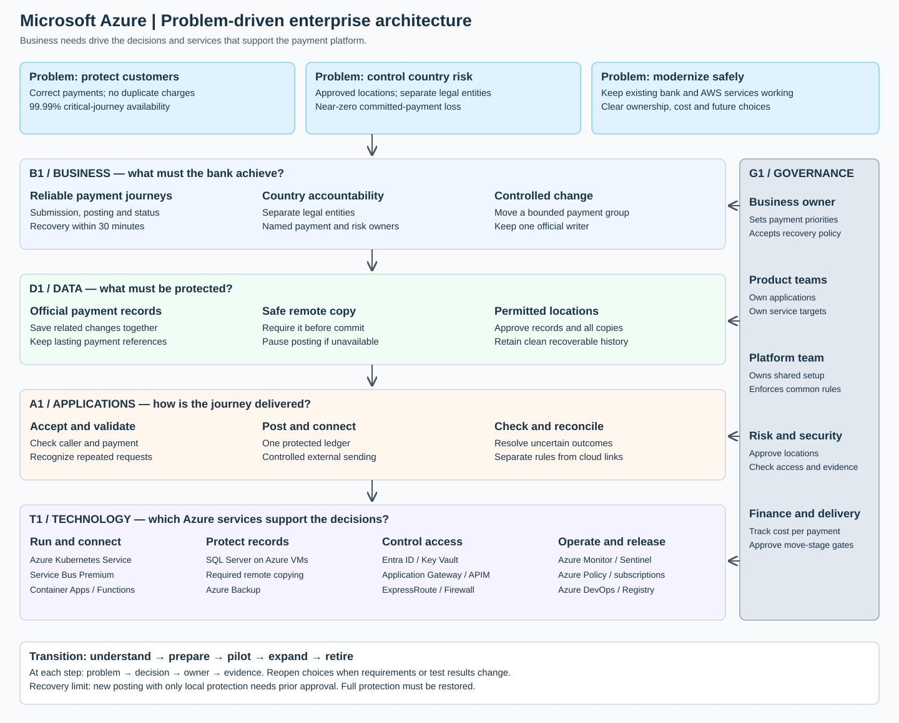

Selected cloud: **Microsoft Azure**

# Payment platform modernization

The proposal starts with the bank’s problems. Business needs drive the application, data and Azure decisions.

## My proposal

> I would start with the payment risks and the decisions the bank needs to make. The goal is to move safely while keeping payments correct and available.
>
> I would separate each legal entity, keep data in approved locations, and use one official payment writer per entity. Existing bank and AWS systems would stay connected during the move.
>
> I would agree the business rules first. Then I would make the data, application and Azure choices that support them. Each major choice would have an owner, a trade-off and a test.

## Supporting material

| Assessment area | Evidence |
|---|---|
| Framing and target design — tasks 1–2 | This paper and the [four architecture views](diagrams.md) |
| Application choice and portability — task 3 | [Platform comparison](appendix.md#1-compare-application-platforms--task-3) |
| Data and recovery — task 4 | [Protection and recovery approach](appendix.md#2-protect-payments-and-recover--task-4) |
| Security — task 5 | [Threat-control matrix](appendix.md#3-threat-control-matrix--task-5) |
| Migration and risks — task 6 | [Roadmap and risk register](appendix.md#4-migration-roadmap--task-6) |
| Contentious choice — task 7 | [Two-page decision record](decision-record.pdf) · [editable text](decision-record.md) |

## 1. Start with the problems

| Problem | Required outcome | Decision |
|---|---|---|
| A failed payment service affects customers across countries. | 99.99% availability for important journeys. | Separate entity systems. Use multiple facilities and ready recovery capacity. |
| Lost or repeated payments create financial exposure. | Near-zero loss of committed payments. No duplicate financial effect. | One official writer. Protected records. Lasting payment references. |
| Countries restrict where records may be kept. | Records and all copies remain in approved locations. | Approve locations per entity before choosing services. |
| Existing systems cannot all move together. | Payments continue throughout the move. | Connect old and new systems. Move one bounded payment group at a time. |
| Teams disagree about platforms and recovery. | Decisions follow common business priorities. | Assign decision owners. Compare alternatives against the same requirements. |
| One platform could become expensive to leave. | Application rules can move with manageable effort. | Separate payment rules from cloud-specific connections. Test a small move. |
| Spending and responsibility can become unclear. | Clear service ownership, audit records and costs. | Shared platform rules. Product-owned service targets and budgets. |

The 30-minute recovery target covers the whole payment journey. It includes detection and approval. It does not replace the 99.99% availability target.

### Principles, assumptions and approval

Protect payment accuracy. Separate legal entities. Keep records and copies in approved places. Make changes in small, reversible steps. Measure full payment journeys rather than individual server health.

The current engine, volumes, response-time limits and approved locations are unknown. I assume the bank can operate the chosen services and control external sending independently of a failed Azure location. Confirm these assumptions before the pilot.

The platform lead owns shared rules. Product leads own applications and service targets. Payment and country-risk owners approve recovery exposure. A small architecture forum resolves cross-team choices. Record each exception with an owner, expiry and removal plan.

99.99% permits about four minutes of downtime in a 30-day month. The proposed 30-minute disaster target can exceed that monthly allowance. Neither target is claimed as demonstrated. Clean recovery after a cyberattack has separate objectives.

## 2. Enterprise architecture view

Read the diagram from top to bottom. Business needs drive the design. Data and application decisions shape the technology choices. Security, ownership and cost apply throughout.

The diagram connects business outcomes to data, applications, technology and accountable owners.

## 3. Split decisions into four architecture areas

| Area | Question to answer | My decision | Accountable owner |
|---|---|---|---|
| **Business architecture** | Which services matter, and who controls them? | Keep payment submission, posting, status checks and settlement clear. Separate legal entities. Agree outage and recovery policies. | Payments business owner; country risk approves location rules. |
| **Data architecture** | Which records are official, and how are they protected? | One payment ledger per entity. Save related changes together. Require a safe remote copy for protected commits. | Data owner with payment operations. |
| **Application architecture** | How do services work together and remain movable? | Separate payment handling, external-bank connections and reconciliation. Use documented requests and messages. Keep cloud connections outside payment rules. | Product engineering lead. |
| **Technology architecture** | Which Azure services support those decisions? | Isolated subscriptions, protected bank connections, application copies across zones and a prepared second location. | Central platform lead. |

The [decision sheet](decisions.md) records why these choices fit, what we reject and when to review them.

## 4. Application platform comparison and decisions

The brief names EKS, ECS, Lambda and EC2 as reference choices. For Azure, compare AKS, Container Apps, Functions and Virtual Machines. These represent different operating models. They are not exact feature matches or proof of the bank's current estate.

Start with each component's needs, then compare the options.

| Component | AKS | Container Apps | Functions | Virtual Machines | My choice |
|---|---|---|---|---|---|
| Core payment API and processing | Direct placement and operating-policy control | Runs container services with less cluster work | Possible, but needs a suitable plan and event design | Flexible, with more maintenance | **AKS**, assuming direct Kubernetes controls are required. Otherwise prefer Container Apps. |
| Reconciliation worker | Fits, but adds cluster dependency | Supports scheduled and event-based jobs | Fits short, bounded checks; larger jobs need careful design | Fits, with computer maintenance to manage | **Container Apps** for the proposed container job. |
| Payment notifications | Fits, but consumes cluster capacity | Fits container-based handlers | Fits short work triggered by a payment event | More maintenance for this small task | **Functions**; keep payment rules outside trigger-specific code. |
| Legacy vendor adapter needing OS-level installation | Needs vendor support for containers | Needs vendor support for containers | Usually needs redesign for this form | Preserves the supported installation | **Virtual Machines** until the vendor supports a safer move. |

For the core path, I assume the platform team requires direct Kubernetes placement and maintenance controls. The question does not establish this need. Confirm it before accepting AKS's support cost. Container Apps can also provide scaling and version-based releases. Those features alone do not justify AKS. [Azure container comparison](https://learn.microsoft.com/en-us/azure/container-apps/compare-options)

Measure busy-period capacity, recovery, response time, operating effort and full cost. Functions behavior depends on its hosting plan. The [detailed comparison and portability table](appendix.md#1-compare-application-platforms--task-3) records the consequences. No hosting choice alone guarantees the payment service target.

### Supporting Azure services

The question does not name the current database, message service, network products or identity service. The choices below are proposed target services. Their existing counterparts must be confirmed during discovery.

| Need | Proposed Azure service or approach | Main trade-off |
|---|---|---|
| Separate entities and enforce shared rules | Azure subscriptions and Azure Policy | Stronger separation adds some operating cost. |
| Protect official payment records | SQL Server on Azure Virtual Machines with required remote copying | Strong protection adds cost and waiting time. A lost connection can pause posting. |
| Exchange work between applications | Service Bus Premium | Delivery can repeat. The receiver must prevent a second financial effect. |
| Connect to bank facilities | ExpressRoute and Azure Firewall | Private connectivity still needs data protection and a backup route. |
| Protect customer entry and access | Application Gateway, API Management and Microsoft Entra ID | Access rules must be tested across both locations. |
| Store secrets and monitor operations | Key Vault, Azure Monitor and Sentinel | Permissions and activity records need country approval. |
| Release software and retain recoverable copies | Azure DevOps, Container Registry and Azure Backup | Approved software and usable saved copies still need verification. |

Existing AWS workloads stay connected during coexistence. Move a workload only after its dependencies, payment behavior and recovery have been checked. New target services use Azure. There is no new AWS recovery platform.

## 5. The main trade-off: payment safety versus continued posting

The brief says near-zero loss. It does not define the permitted number or value of missing payments. I propose zero lost committed records for one covered location failure. This is a stricter design assumption, not an extra requirement stated in the question. A commit is a completed database change, even if its reply never reached the customer.

I prefer this assumption until the payment owner defines an acceptable loss. It avoids inventing an allowance for missing payments. It also costs more and can interrupt posting during connection failures. Compare that cost with a simpler managed database that copies changes later. If a measurable loss tolerance is approved, reassess the managed option. [Azure SQL recovery limits](https://learn.microsoft.com/en-us/azure/reliability/reliability-sql-database)

Under the selected design, the second location must save each change before the main database completes it. Pause new posting when that protection is unavailable. Do not return a successful payment result for unfinished work.

After losing a location, restarting payments with only local protection needs prior bank approval. A second location failure could then lose new payments. If the bank forbids this exposure, posting must wait for another safe remote copy. Full recovery within 30 minutes cannot then be promised by this two-location design.

These are explicit business choices. The system must not silently reduce protection to appear available.

## 6. Deliver and review in small steps

| Delivery step | What I would produce |
|---|---|
| Set the vision and scope | Important journeys, stakeholders, constraints and success measures. |
| Understand the current state | Existing bank/AWS connections, data locations, operating gaps and unknowns. |
| Describe the target | Business, data, application and technology views linked to the problems. |
| Compare gaps and options | Changes needed, decisions, risks and owners. |
| Plan delivery | Foundations, lower-risk services, one payment pilot, then controlled expansion. |
| Govern and review | Evidence before each move. Time-limited exceptions. Reopen decisions when requirements change. |

Track requirements and evidence at every move. Reopen a decision when its assumptions change.

## 7. What must be proved

Before the pilot, test entity separation, a failed facility and a failed location. Count missing committed records. Measure full recovery time. Leave the old system running during a connection failure and prove it cannot send conflicting payments.

Also test a payment accepted externally whose reply is lost. Retrying the same reference must not charge twice. Restore a clean saved copy and check balances.

Country locations, current database compatibility, peak volume, response-time limits and gateway controls remain assumptions to confirm. No deployed system or test result is claimed.

## Official sources

- [Microsoft: platform and application responsibilities](https://learn.microsoft.com/en-us/azure/cloud-adoption-framework/ready/landing-zone/).
- [Azure application-running options](https://learn.microsoft.com/en-us/azure/architecture/guide/technology-choices/compute-decision-tree).
- [Azure Functions hosting plans](https://learn.microsoft.com/en-us/azure/azure-functions/functions-scale).
- [Microsoft: required database-copy controls](https://learn.microsoft.com/en-us/sql/t-sql/statements/alter-availability-group-transact-sql?view=sql-server-ver17).

The [source list](sources.md) states what each official reference supports. These sources describe service behavior; they do not validate this design.

The [supporting diagrams](diagrams.md) show the context, payment flow, locations and recovery. The [appendix](appendix.md) provides the short comparison, control, delivery and risk tables.
