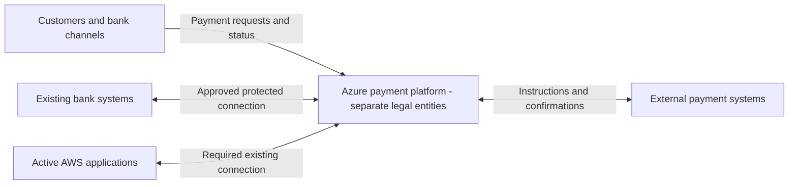
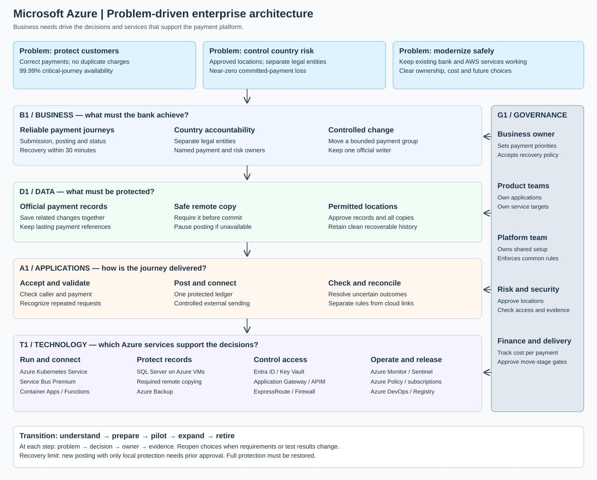
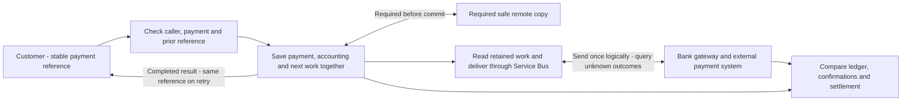
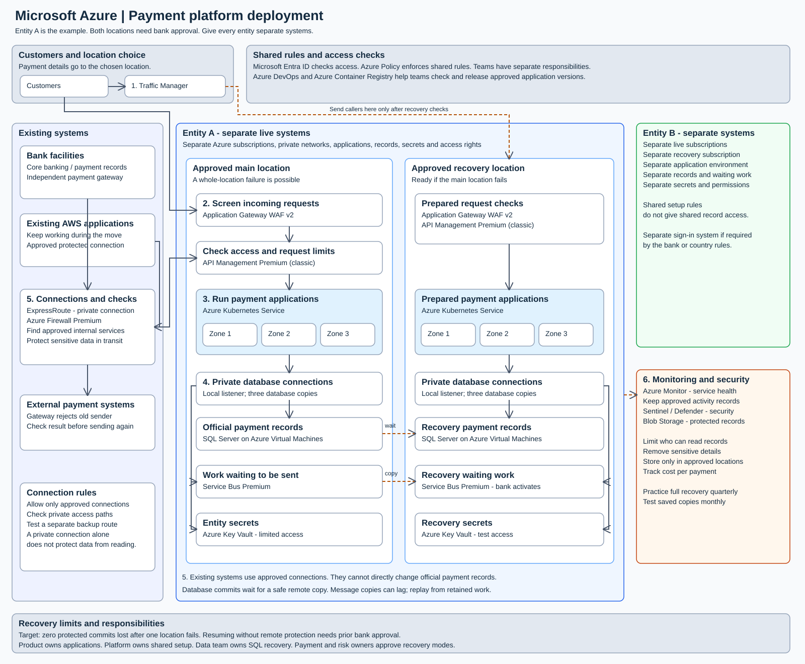
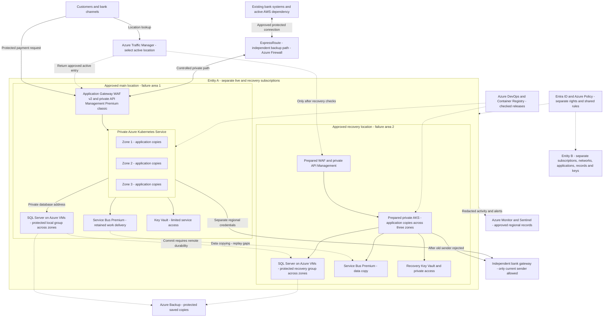
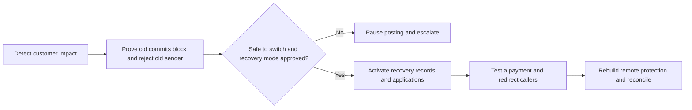

Selected cloud: **Microsoft Azure**

# Architecture diagrams

Each diagram answers a different question: who connects, how a payment moves, where systems run, and how recovery works.

## Context — who needs the platform?

## Enterprise layers — which decisions support the outcome?

Business sets the outcome. Data sets the protection rules. Applications deliver the payment journey. Technology provides the required services. Governance checks that these decisions stay connected.

## Logical payment flow — how is one payment handled?

The stored work item is part of the payment transaction. Publishing a message is a later step. A repeated delivery must not create another charge. Use the original reference to resolve an uncertain external result.

## Deployment — where are the boundaries?

Solid arrows show request and access paths. Dotted arrows show copying, location selection or supporting controls. The two locations are separate failure areas. Each needs approved services and enough capacity for a zone failure.

Request checks and stored records have private network access. Restrict network paths and application permissions separately. Verify where Azure Firewall inspection applies; private access alone does not prove inspection. ExpressRoute is not encrypted by default. Protect sensitive traffic and test an independent backup route. [Microsoft connection guidance](https://learn.microsoft.com/en-us/azure/expressroute/expressroute-about-encryption)

Use API Management Premium (classic) with explicit zone configuration and capacity. Keep both locations ready. AKS application copies need enough surviving-zone capacity. [API Management behavior](https://learn.microsoft.com/en-us/azure/reliability/reliability-api-management), [AKS baseline](https://learn.microsoft.com/en-us/azure/architecture/reference-architectures/containers/aks/baseline-aks)

The gateway is outside the failed location. Its sender controls are an assumption to prove. Activity records, keys and backups need approved locations too. The standalone drawing summarizes the same boundaries; the text supplies operational detail.

## Recovery — what decision does the incident leader make?

Target full recovery within 30 minutes. Include detection and approval time. New posting without a healthy remote copy requires an agreed temporary policy. Otherwise, wait for another safe copy. Recovery from corruption or attack follows a separate clean-restore process.
